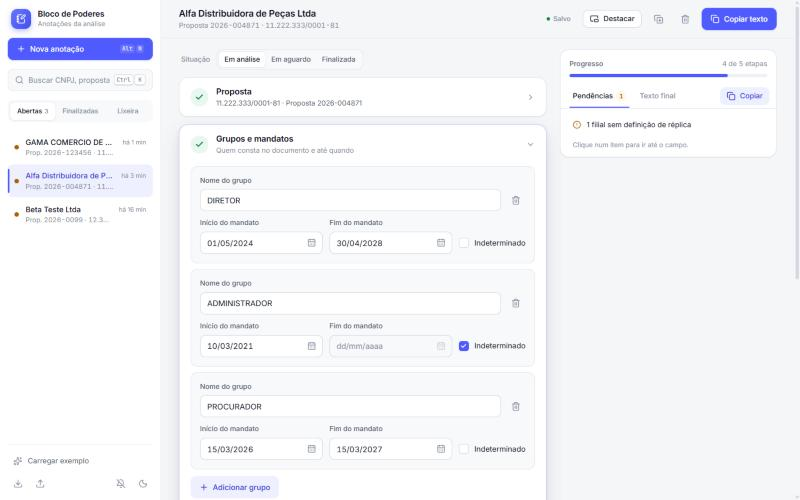
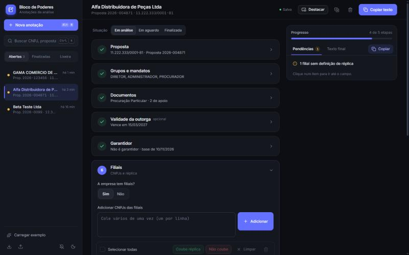

<div align="center">

# 📝 Bloco de Poderes

**O bloco de notas da análise de poderes de clientes PJ, só que ele lembra das coisas por você.**

Segue a ordem do trabalho do analista, avisa o que está faltando, impede o esquecimento da validação da procuração particular e gera o texto da anotação pronto para colar.


**[🌐 Abrir o Bloco de Poderes](https://diogotex0.github.io/bloco-de-notas-tcs/)**




</div>

---

## 💡 Por que existe

Na análise de poderes, o analista anota CNPJ, proposta, grupos, mandatos, documentos, garantidor, filiais e formas de assinatura, e depois escreve a anotação final. Na prática:

- **Esquece-se de anexar a validação** da procuração particular (o erro mais comum);
- **Esquece-se a data e a origem** do documento de apoio;
- Perde-se tempo **digitando e formatando** o mesmo texto toda vez.

O Bloco de Poderes resolve isso **sem mexer em nenhum sistema interno**: é só uma página que abre no navegador.

> ⚠️ A ferramenta **não interpreta documentos** e não toma decisões. A análise continua sendo do analista; o bloco só organiza, lembra e formata.

---

## ✨ O que ele faz

### Anotação guiada, em 8 etapas
| # | Etapa | O que tem |
|---|---|---|
| 1 | **Proposta** | CNPJ com máscara e validação (inclusive o novo CNPJ alfanumérico), nº da proposta, razão social, situação na Receita, botão que copia o CNPJ e abre a consulta da Receita |
| 2 | **Grupos e mandatos** | Grupos com nome livre, início e fim do mandato ou indeterminado, aviso de mandato vencido |
| 3 | **Documentos** | Recebidos na proposta e de apoio (data e origem: Busca, Junta Comercial, Sharefiche 1/2 ou outro). Junta Comercial já marca "anexado na proposta" |
| 4 | **Validade da outorga** | Emissão + validade → calcula o vencimento e avisa se venceu |
| 5 | **Garantidor** | Sim/Não + data da base (já vem com a última data usada) |
| 6 | **Filiais** | Colar vários CNPJs de uma vez, marcar "coube / não coube réplica" em lote, lista organizada automaticamente |
| 7 | **Formas de assinatura** | Grupos isolados ou em conjunto, limite em R$ ou sem limite, autorização necessária, quóruns |
| 8 | **Anotações** | Campo livre |

Só uma etapa fica aberta por vez; as fechadas mostram um resumo do que já foi preenchido.

### 🔒 Proteções contra esquecimento
- **Procuração particular:** a cópia do texto fica **bloqueada** até confirmar a validação (ITI ou outro meio).
- **Conferência de anexos:** antes de copiar ou finalizar, uma lista curta pede para confirmar que você anexou a validação, os documentos da Junta e as evidências.
- **Faixa "Falta anexar"** no topo enquanto houver anexo pendente.
- **Lembrete ao sair** (opcional): notificação do Windows se você trocar de tela com anexo pendente.
- **Checklist clicável:** cada pendência leva direto ao campo.

### ⚡ Para ir mais rápido
- **Texto final pronto** no modelo do time, com botão **Copiar** (e copiar por partes: só grupos, documentos, filiais ou assinaturas).
- **Colar inteligente:** aperte <kbd>Ctrl</kbd>+<kbd>V</kbd> fora dos campos e o bloco descobre o que é (CNPJ, vários CNPJs → filiais, nº da proposta, razão social, data → pergunta o campo).
- **Data rápida:** digite `010524` → 01/05/2024. Também aceita `hoje` e `ontem`.
- **Teclado:** <kbd>Enter</kbd> vai para o próximo campo, <kbd>Ctrl</kbd>+<kbd>Enter</kbd> para a próxima etapa, letras escolhem opções (<kbd>S</kbd>/<kbd>N</kbd>).
- **Reaproveitar análise:** se o CNPJ já tem uma análise anterior, oferece copiar grupos, documentos e filiais.
- **Janela flutuante:** botão **Destacar** abre o bloco numa janelinha que fica por cima do Salesforce, PDF etc.

### 🗂️ Organização
- Situação da anotação: **Em análise · Em aguardo · Finalizada**, com abas na lista lateral.
- **Lixeira** de 30 dias, com restaurar e excluir de vez.
- **Desfazer** em toda remoção.
- Busca por CNPJ, proposta ou nome.
- **Backup** em arquivo (exportar / importar).
- Modo **claro e escuro**.

---

## 🚀 Como usar

### Usar online
👉 **[diogotex0.github.io/bloco-de-notas-tcs](https://diogotex0.github.io/bloco-de-notas-tcs/)**

Abre direto no navegador. As anotações ficam salvas só no seu computador.

### Usar offline (sem instalar nada)
1. Baixe o arquivo [`dist-portatil/index.html`](dist-portatil/index.html).
2. Dê dois cliques. Ele abre no navegador e funciona **offline**.
3. Clique em **Ver um exemplo** para conhecer tudo com dados fictícios.

> 💡 Crie um atalho na área de trabalho para esse arquivo.

### Para desenvolver
Precisa do [Node.js](https://nodejs.org/) 20 ou mais novo.

```bash
npm install
npm run dev              # abre em http://localhost:5173
npm run build:portatil   # gera dist-portatil/index.html (um arquivo só)
```

---

## ⌨️ Atalhos

| Atalho | O que faz |
|---|---|
| <kbd>Alt</kbd>+<kbd>N</kbd> | Nova anotação |
| <kbd>Alt</kbd>+<kbd>C</kbd> | Copiar o texto final |
| <kbd>Ctrl</kbd>+<kbd>K</kbd> | Buscar anotação |
| <kbd>Enter</kbd> | Próximo campo |
| <kbd>Ctrl</kbd>+<kbd>Enter</kbd> | Próxima etapa |
| <kbd>S</kbd> / <kbd>N</kbd> (e setas) | Escolher a opção selecionada |
| <kbd>Ctrl</kbd>+<kbd>V</kbd> (fora de campo) | Colar inteligente |
| <kbd>Ctrl</kbd>+<kbd>Enter</kbd> (nas filiais) | Adicionar os CNPJs colados |

---

## 🔐 Privacidade

- **Nada é enviado para a internet.** As anotações ficam salvas só no navegador de quem usa (`localStorage`).
- Não há login, servidor nem banco de dados.
- Fontes e bibliotecas vão embutidas no arquivo; a página não faz nenhuma requisição externa.
- O único link externo é o botão **Receita**, que abre a consulta pública de CNPJ quando você clica.
- **Use só dados fictícios** em testes e demonstrações.

---

## 🧱 Como é feito

| | |
|---|---|
| Interface | React 19 + TypeScript |
| Estilo | Tailwind CSS 4, com tokens de cor para tema claro e escuro |
| Animações | Motion |
| Estado | Zustand (+ Immer), salvo no `localStorage` com validação dos dados |
| Ícones | Lucide |
| Build | Vite (+ versão portátil em arquivo único) |

```
src/
├── lib/            regras: CNPJ, datas, pendências, texto final, anexos, colar inteligente, teclado
├── store/          estado e salvamento (anotações, interface, avisos)
└── components/
    ├── sections/   uma tela para cada etapa
    ├── MiniApp     versão compacta da janela flutuante
    └── ...         barra lateral, painel de pendências, diálogos
```

---

## 🗺️ Próximos passos

- [ ] Tour de boas-vindas e colinha de atalhos dentro do bloco
- [ ] Biblioteca de textos prontos (quóruns e autorizações)
- [ ] Extensão de navegador que lê CNPJ e nº da proposta da página do Salesforce
- [ ] Integração oficial (depende de liberação)

---

<div align="center">
Feito para facilitar o dia a dia da análise de poderes. 💙
</div>
